

<h1 align="center">אוהל · Ohel</h1>

<b>אוהל פתוח לתנ״ך.</b> לקרוא, לראות על מפת לוויין בתלת־ממד ולדבר על זה ביחד, בעברית ובאנגלית.

<a href="https://ohel.salvinorinab.workers.dev"><b>← להיכנס לאוהל</b></a> &nbsp;·&nbsp; <a href="README.md">Read in English</a>

  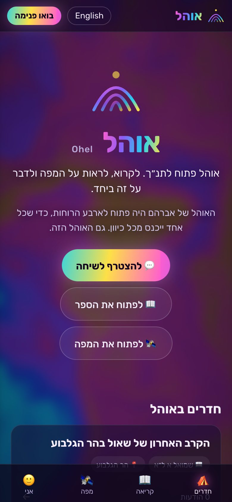
  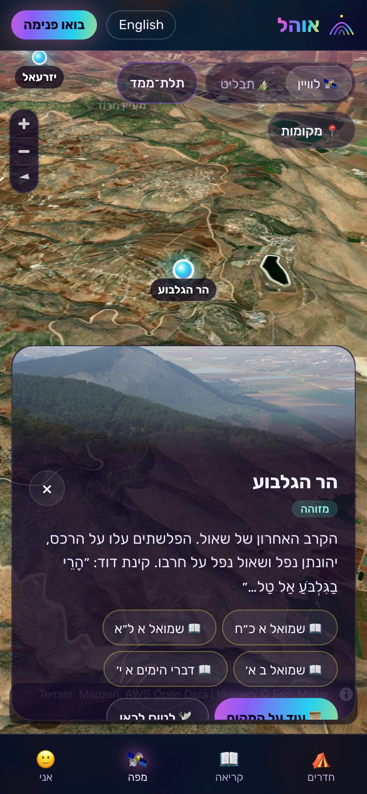
  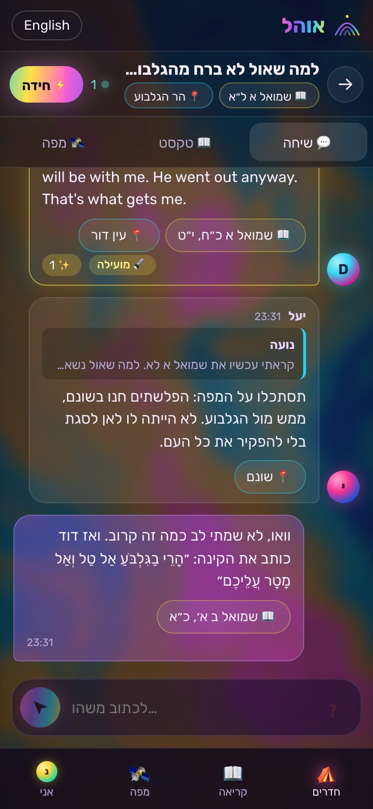

השם בא מהאוהל של אברהם באלוני ממרא, שהיה פתוח לארבע רוחות השמיים כדי שכל אחד יוכל להיכנס מכל כיוון. בלי פרסומות, בלי סמלים של דת אחת, ובלי צורך במייל. יהודים, נוצרים, מוסלמים ומי שלא מאמינים, כולם מוזמנים.

## מה יש באוהל

### 🛰️ המפה: 103 מקומות מהתנ״ך בתלת־ממד

צילומי לוויין ותבליט אמיתי, מאור ובבל ועד סיני, הגלבוע והר הזיתים. כל מקום מסומן כמזוהה, מסורתי או שנוי במחלוקת, עם סיפור קצר והפרקים שבהם הוא מופיע.

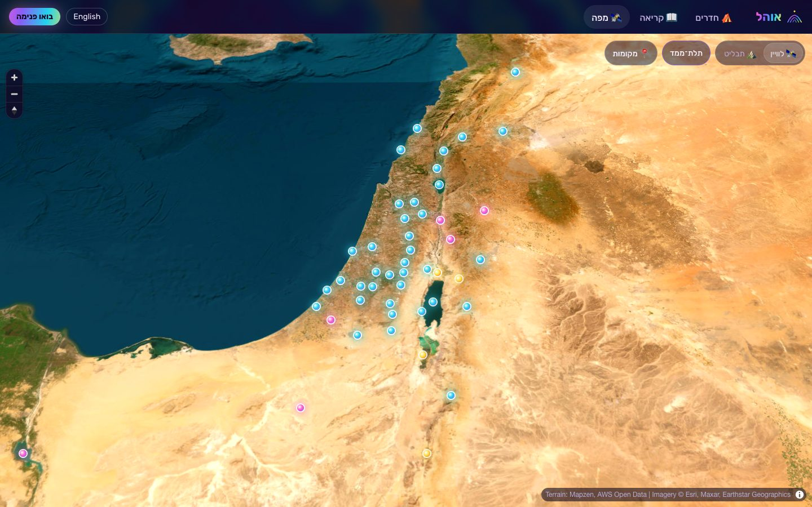

לכל מקום יש עמוד עמוק משלו: איך המקום נראה היום, העמים שחיו בו, מי שלט בו, כמה אנשים חיו בו אז, ארכאולוגיה וממצאים במוזיאונים, תמונות ויצירות אמנות (מוויקישיתוף, כל אחת עם היוצר והרישיון שלה), ציר זמן וכל הפרקים שמזכירים אותו. כשהחוקרים חלוקים, העמוד אומר את זה.

  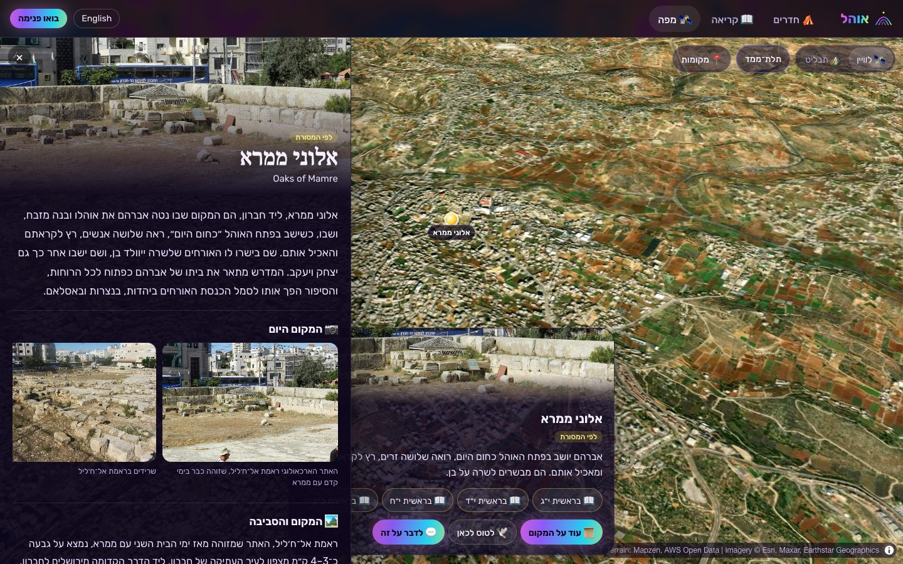
  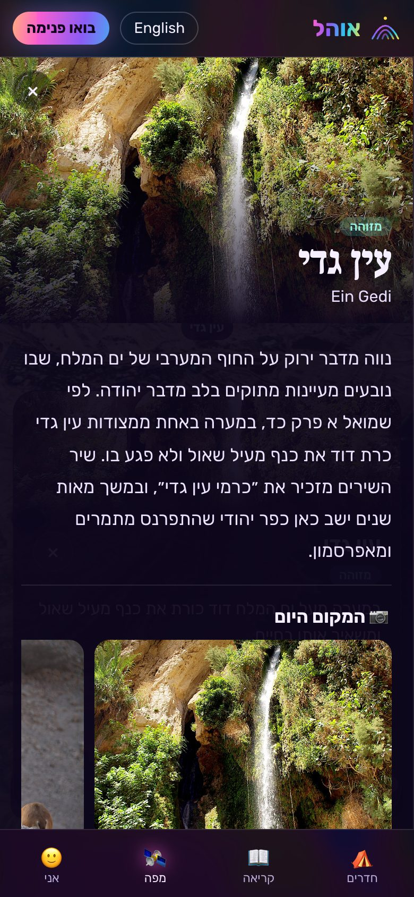

**מי שלט כאן:** לחיצה על שליט בעמוד של מקום מציירת על המפה את גבולות הממלכה שלו, ממצרים ואשור ועד פרס (הגבולות מ־Cliopatria של מאגר Seshat).

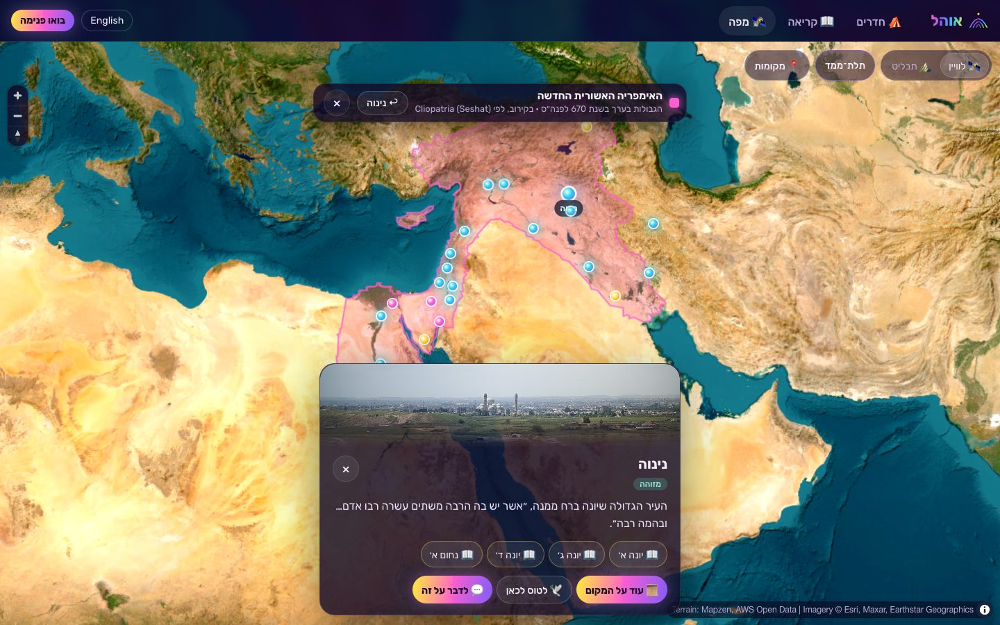

### 👥 הדמויות של התנ״ך

ל־31 דמויות יש עמוד משלהן, מנח ואברהם ועד אסתר ונחמיה. בכל עמוד: הסיפור פרק אחר פרק עם הפסוקים, המקומות של החיים שלהן על המפה (והמסע, אם יש), משפחה, מי היו באמת, איך יהודים, נוצרים ומוסלמים זוכרים אותן, ומה ההיסטוריה והארכאולוגיה יכולות לומר ומה לא. בכל עמוד מקום מופיעות הדמויות שהסיפור שלהן עובר בו.

  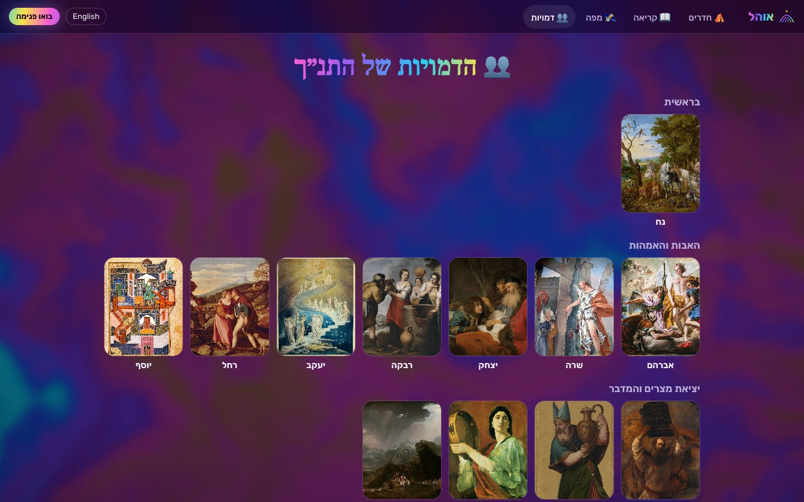
  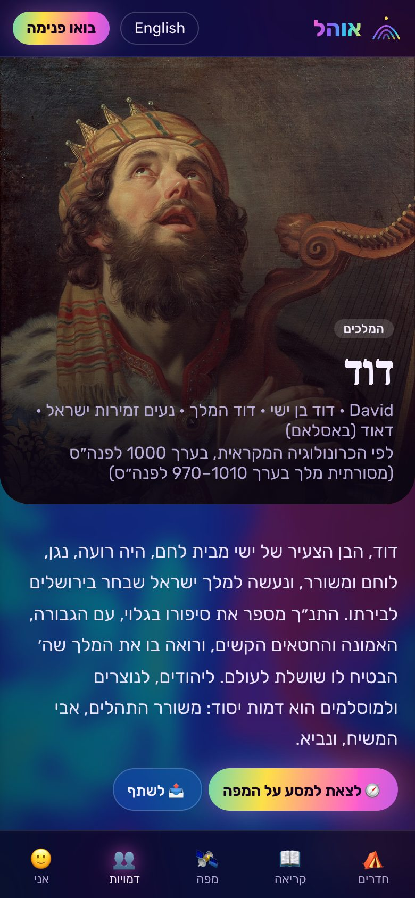

### 🧭 מסעות

שישה מסעות שמתנגנים על המפה תחנה אחר תחנה, עם הפסוק של כל תחנה: אברהם, יעקב, יציאת מצרים (המסלול המסורתי, שמסומן כשנוי במחלוקת), דוד בורח משאול, אליהו, והגלות לבבל והשיבה. המצלמה טסה מתחנה לתחנה והדרך מצטיירת תוך כדי. כתובת כמו ‎/journey/jacob פותחת מסע ישירות.

### 📖 הקורא

כל התנ״ך מספריא, בעברית, באנגלית או זה לצד זה. ניקוד וטעמים לפי בחירה, כתיב וקרי. בכל פרק מופיעים המקומות שלו על המפה.

### 🔥 חדרים

צ׳אט קבוצתי חי על סיפור, שאלה או מקום. אפשר לצרף פסוק, מקום או בדיוק את מה שרואים עכשיו על המפה, וזה נפתח לכולם באותה נקודה. שאלות בולטות בחדר, ומי ששאל יכול לסמן את התשובה שהכי עזרה. ✨ אור הוא תודה להודעה שהאירה משהו, ו־⚡ חידון עונים כל החדר ביחד.

  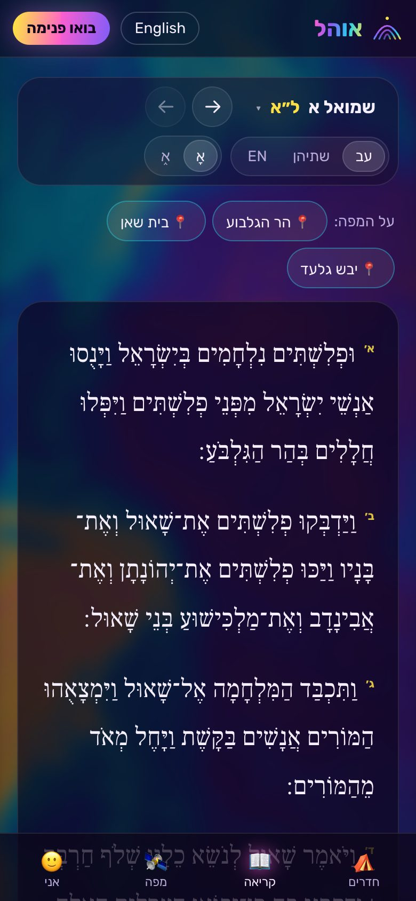
  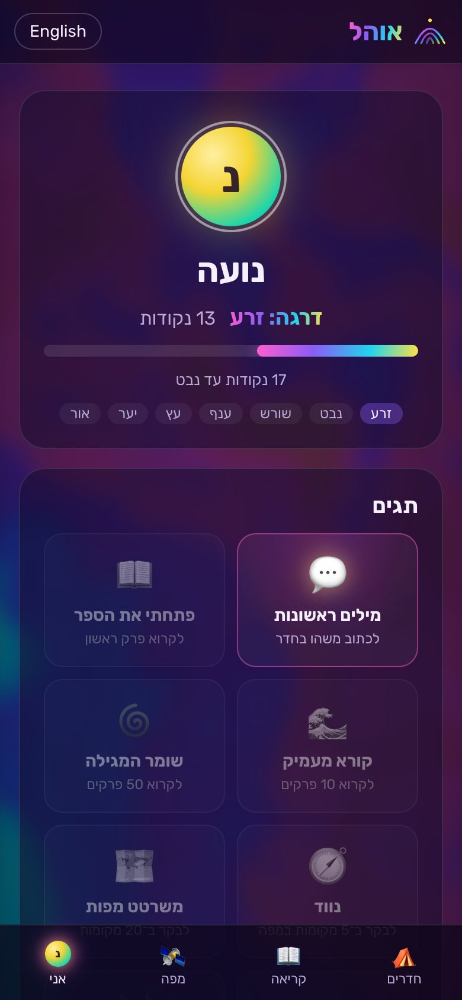

### 🗓️ השבוע על המפה, ושאלה כל יום

בדף הבית מופיעות פרשת השבוע וההפטרה (לפי לוח ארץ ישראל, מ־Hebcal) עם כל המקומות על המפה שהפסוקים שלהן מזכירים. הדף ‎/week נועד לשליחה בוואטסאפ כל שבוע. לידן יש שאלת היום: אותה שאלה לכולם, נקודות על כל תשובה ותג על שבעה ימים ברצף.

### 🚪 הרשמה, או כניסה כאורח

נרשמים עם שם משתמש וסיסמה (בלי מייל) ונכנסים מכל טלפון או מחשב. לכל משתמש יש פרופיל: תמונה, השם שאחרים רואים, צבע וכמה מילים. אפשר גם להיכנס כאורח עם שם בלבד, שנשמר במכשיר הזה, ולהירשם אחר כך בלי לאבד כלום. הסיסמה עוברת עיבוד בדפדפן (PBKDF2) לפני שהיא נשלחת, ובשרת נשמר רק גיבוב מעורבל שלה. אם שוכחים את הסיסמה, המפתח של החשבון מחזיר אותך. מנהלים יכולים להסיר תמונה או מילים שלא מתאימות.

  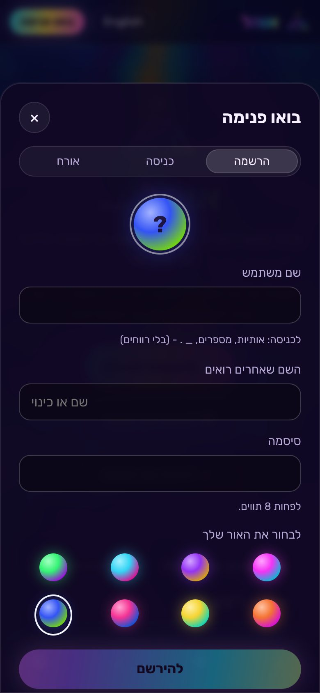
  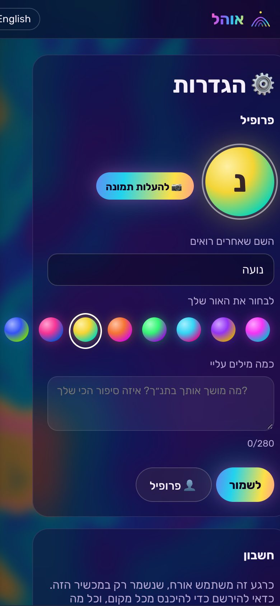

### 🌱 נקודות, רמות ותגים

זרע ← נבט ← שורש ← ענף ← עץ ← יער ← אור. 17 תגים וטבלה שבועית, על קריאה, סיור במפה, שיחה, חידונים, תשובות שעזרו ואורות.

## שומרים על אוהל נעים

השרת חוסם קללות ועלבונות בעברית ובאנגלית, גם כשמנסים לעקוף אותו עם אותיות דומות, ניקוד, רווחים או נקודות. מילים שהתנ״ך עצמו משתמש בהן נשארות מותרות. הודעה שנחסמה לא מגיעה לאף אחד, והכותב מקבל אותה בחזרה כדי לנסח מחדש. יש צוות מנהלים שיכול להסתיר הודעות ולהשתיק או לחסום. כל הכללים נמצאים בדף "כללי האוהל ופרטיות" באתר.

## למפתחים

הוראות הרצה, בדיקות, העלאה ומבנה הקוד נמצאות ב־[README באנגלית](README.md#keeping-it-kind).

## קרדיטים

טקסט: [ספריא](https://www.sefaria.org). עברית: מקרא על פי המסורה (CC BY-SA). אנגלית: JPS (CC BY-NC). צילומי לוויין © Esri, Maxar, Earthstar Geographics. תבליט: Mapzen / AWS Open Data. גופנים: Rubik ו־Frank Ruhl Libre. תמונות המקומות: ויקישיתוף (היוצר והרישיון על כל אחת). גבולות הממלכות: [Cliopatria](https://github.com/Seshat-Global-History-Databank/cliopatria) ממאגר Seshat (CC BY 4.0), בפישוט.
