<p align="center"></p>
<h1 align="center">Ohel · אוהל</h1>
<p align="center"><b>An open tent for the Bible.</b><br>Read it, see it on a 3D satellite map, and talk it through together, in Hebrew and English.</p>
<p align="center"><a href="https://ohel.salvinorinab.workers.dev"><b>Open Ohel →</b></a> &nbsp;·&nbsp; <a href="README.he.md">לקריאה בעברית</a></p>

<p align="center">
  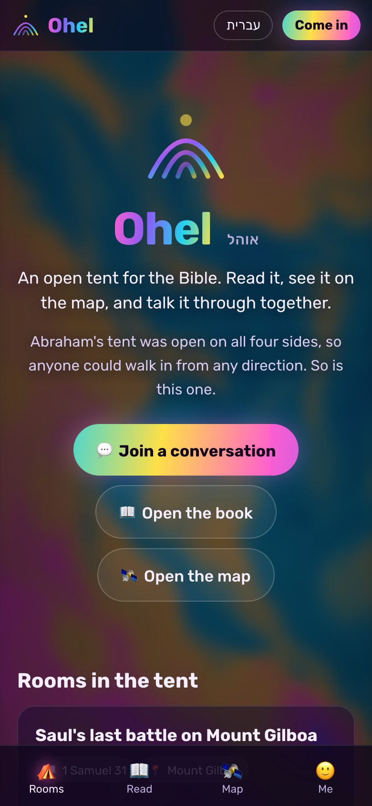
  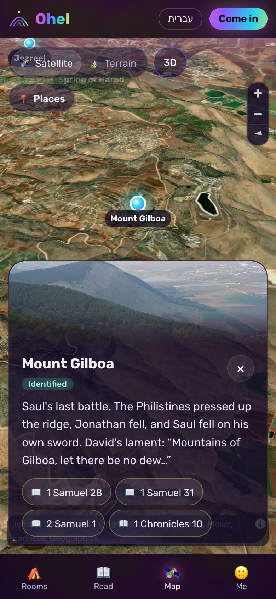
  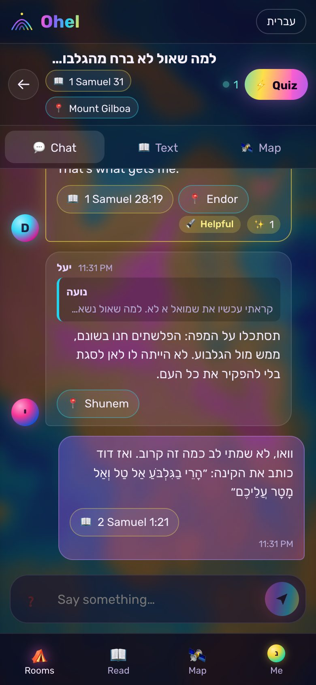
</p>

The name comes from Abraham's tent at Mamre, which was open on all four sides so anyone could walk in from any direction. No ads, no religious symbols, no email needed. Jews, Christians, Muslims and people of no faith are all welcome.

## What's inside

### 🛰️ The map: 103 places of the Bible in 3D

Satellite imagery and real terrain, from Ur and Babylon to Sinai, Gilboa and the Mount of Olives. Each place is marked as identified, traditional or debated, with a short story and the chapters where it appears.

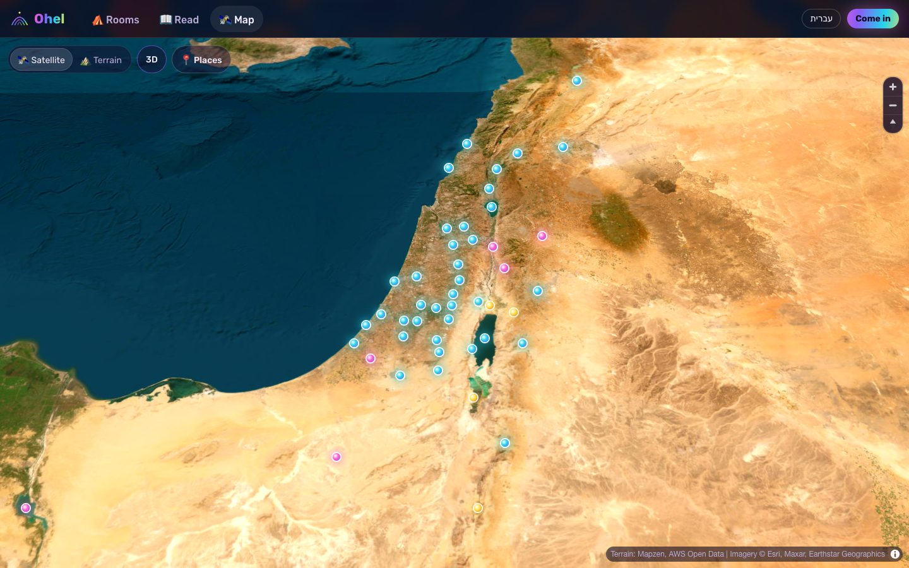

Every place has its own deep page: the setting today, the peoples who lived there, who ruled it, how many people lived there then, archaeology and museum finds, photos and art (Wikimedia Commons, each with its author and license), a timeline, and every chapter that mentions it. Where scholars disagree, the page says so.

<p align="center">
  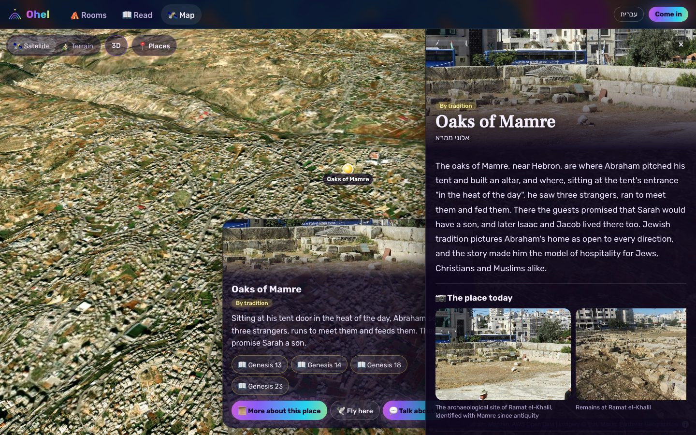
  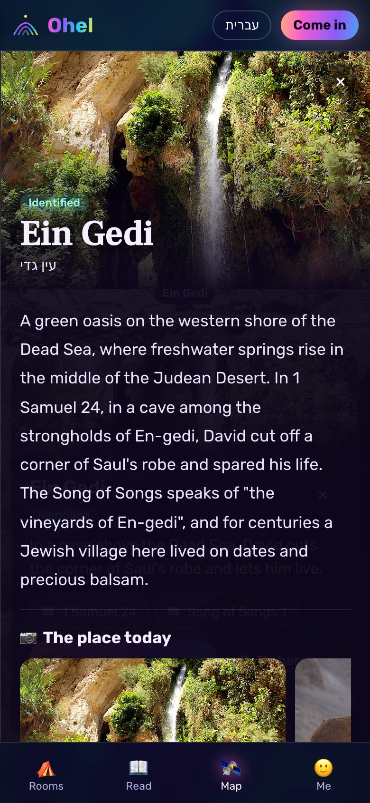
</p>

**Who ruled here:** a ruler on a place page draws that kingdom's borders on the map, from Egypt and Assyria to Persia (borders from the Seshat databank's Cliopatria).

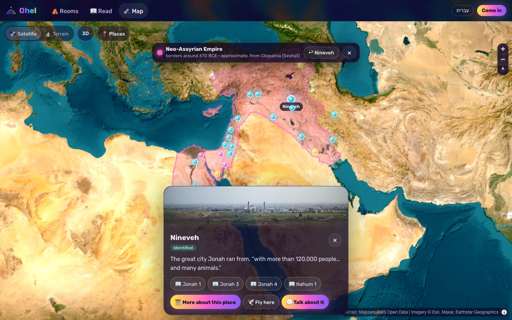

### 👥 People of the Bible

31 people have their own page, from Noah and Abraham to Esther and Nehemiah: their story chapter by chapter with the verses, the places of their life on the map (and their journey, where there is one), family, who they were, how Jews, Christians and Muslims remember them, and what history and archaeology can and can't say. Every place page lists the people whose story passes through it.

### 🧭 Journeys

Six journeys played on the map, stop by stop, with the verse for each stop: Abraham, Jacob, the Exodus (the traditional route, marked as debated), David on the run from Saul, Elijah, and the exile to Babylon and the return. The camera flies from stop to stop while the road draws itself; `/journey/<id>` opens one directly.

### 📖 The reader

The whole Tanakh from Sefaria, in Hebrew, English, or side by side. Vowels and cantillation on or off, ketiv/qere shown. Each chapter lists its places on the map.

### 🔥 Rooms

Live group chat about a story, a question or a place. Attach a verse, a place, or the exact map view you are looking at, and it opens the same spot for everyone. Questions stand out, the asker can mark the most helpful answer, ✨ lights thank a message that lit something up, and ⚡ quizzes are answered by the whole room together.

<p align="center">
  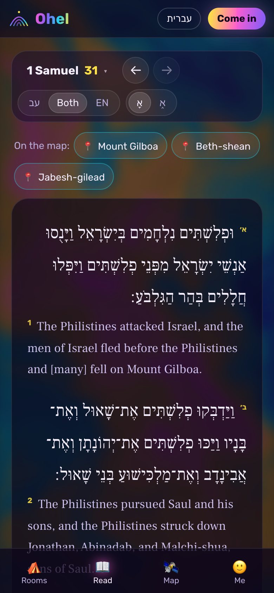
  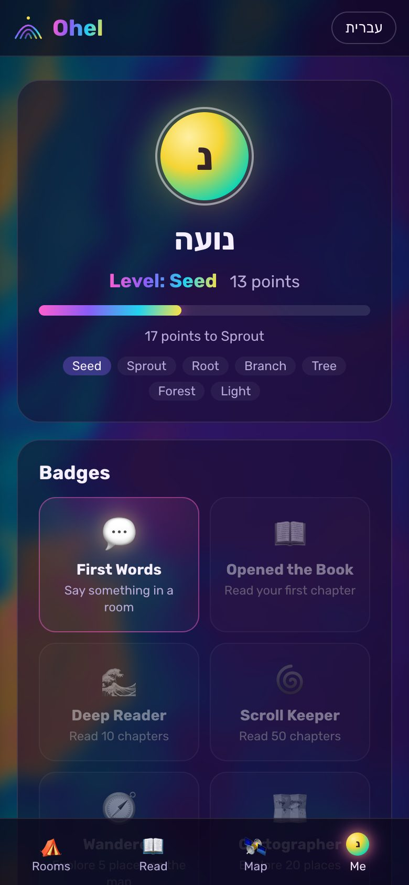
</p>

### 🗓️ This week on the map, and a question a day

The home page shows this week's Torah portion and haftarah (Israel calendar, from Hebcal) with every place on the map that those verses mention, and `/week` is a page made to be sent around on WhatsApp every week. Next to it is the question of the day: the same question for everyone, points for answering, and a badge for seven days in a row.

### 🚪 Sign up, or come in as a guest

Sign up with a username and password (no email) to come in from any phone or computer, with a profile: a photo, the name others see, a colour and a few words about yourself. Or come in as a guest with just a name, kept on that device; a guest can sign up later and keep everything. The password is stretched in the browser (PBKDF2) before it is sent, and the server keeps only a salted hash of that; the account's own key is the way back if the password is forgotten. Admins can remove a photo or words that don't belong.

<p align="center">
  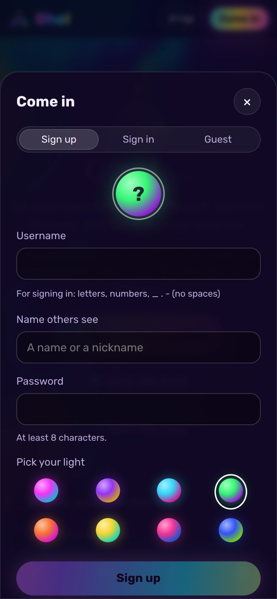
  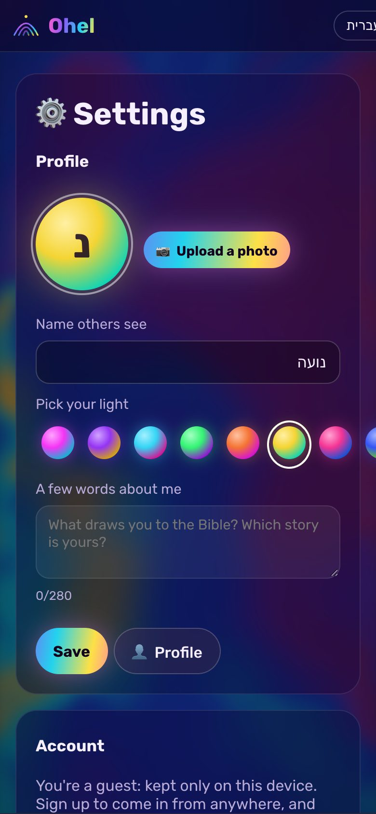
</p>

### 🌱 Points, levels and badges

Seed → Sprout → Root → Branch → Tree → Forest → Light. 17 badges and a weekly board, for reading, exploring the map, talking, quizzes, helpful answers and lights.

## Keeping it kind

`worker/moderation.ts` blocks slurs and curses in Hebrew and English on the server. It sees through look-alike letters, niqqud, leetspeak (`sh1t`), spaced-out letters (`f u c k`), dots (`f.u.c.k`), Hebrew final letters and prefixes. Words the Bible itself uses stay allowed: Rahab is "הזונה", the runner in 2 Samuel 18 is "הכושי", "כוס" is a cup, Balaam's ass, shittim wood. Only the insulting phrases built from them are blocked.

- A blocked message never reaches anyone. The writer gets a gentle note and their text back so they can rephrase it.
- Strikes: a curse counts 1 and a slur counts 2. Strikes fade by one per clean week. 3 strikes → 1 hour pause, 6 → 1 day, 9 → the account can't post anymore and that network can't sign up for 30 days.
- Three reports from different people hide a message and give its author a strike. Reporting a message hides it for you right away.
- Rate limits: 6 messages per 10 seconds, and 30 sign-ups per network per day.

### The team (admins)

Admins are user ids listed in the `ADMIN_IDS` secret (comma separated). Each person's id is on their Me page. Set it with
`echo "<id>,<id>" | npx wrangler secret put ADMIN_IDS`, or in `.dev.vars` locally. No passwords: an admin is recognised by their own key.

- In a room, tapping a message gives admins: hide for everyone / bring back, pause 1 hour, pause 1 day, block (two taps).
- `/admin` shows how busy the tent is, reported messages (with the original words), paused/blocked/warned people, the rooms people opened (delete with two taps) and the latest messages.
- Admin names carry a "Team" label in chat. "צוות", "admin" and similar names are reserved, so nobody else can look like the team.
- `/about` holds the house rules and the privacy page. Keep it in step with the code.

## Run it

```sh
npm install
npm run dev        # http://localhost:5173 (worker + Durable Object + Vite together)
npm test           # moderation tests (72)
node scripts/e2e.mjs http://localhost:5173   # two people chat, ask, light, report, quiz (26 checks)
OHEL_ADMIN_TOKEN=<an admin's key> node scripts/admin-e2e.mjs http://localhost:5173   # admin tools (23 checks)
node scripts/og.mjs   # re-render the link-preview picture public/og.jpg from scripts/og.html
npm run people     # check content/people/*.json and build public/data/people (same image checks)
npm run places     # check content/places/*.json and build public/data/places (image credits from Commons; --offline reuses the last lookup)
node --max-old-space-size=4096 scripts/build-realms.mjs <cliopatria.geojson>   # realm borders → public/data/realms.json
node scripts/daily-e2e.mjs http://localhost:5173   # question of the day (11 checks)
node --experimental-strip-types scripts/accounts-e2e.mjs http://localhost:5173   # accounts and profiles API (25 checks)
node scripts/accounts-ui-e2e.mjs http://localhost:5173   # sign up, photo, profile, sign in, in headless Chrome (9)
node scripts/session-e2e.mjs http://localhost:5173   # staying signed in: cookie, personal link, sign-out (9)
node scripts/shots.mjs http://localhost:5300   # README screenshots (local server only: it posts a demo conversation)
```

Search engines: every place has its own address in each language, `/place/<id>` and `/place/<id>?lang=en`. The Worker (`worker/seo.ts`) writes the whole page into the HTML with its title, description, canonical and `hreflang` links and schema.org data, and serves `/sitemap.xml` and `/robots.txt`. Rooms, `/me` and `/admin` are `noindex`, so people's messages stay out of search results. For Google Search Console, put the HTML-tag code in `GOOGLE_SITE_VERIFICATION` in `wrangler.jsonc`.

Link previews: pages go through the Worker (`run_worker_first`), which writes a title, description and `og:image` per room, place and chapter, so links shared on WhatsApp look right. Visits are counted with Cloudflare Web Analytics (no cookies); the beacon is added only on the real host, from `ANALYTICS_TOKEN` in `wrangler.jsonc`.

Deploy to Cloudflare Workers with `npm run deploy` (builds, then `wrangler deploy`). Everything runs on one Worker and one SQLite-backed Durable Object, with no other services to set up. It fits the free plan for a small community.

## Layout

```
shared/   books (Tanakh), places (map), game (points/levels/badges), protocol (types)
worker/   index.ts (routes + Sefaria proxy with edge cache), hub.ts (the Durable Object),
          seo.ts (place pages for search engines, sitemap), moderation.ts, quiz.ts
src/      React app: views/Home, Room, Reader, MapView, PlacePage, Profile; components; i18n.ts
content/  places/<id>.json: the place pages (how to write one: content/places/README.md)
          people/<id>.json: the people pages (content/people/README.md)
docs/     screenshots/he, screenshots/en (made by scripts/shots.mjs)
```

## Credits

Text: [Sefaria](https://www.sefaria.org). Hebrew: Miqra according to the Masorah (CC BY-SA). English: JPS (CC BY-NC). Imagery © Esri, Maxar, Earthstar Geographics. Terrain: Mapzen / AWS Open Data. Fonts: Rubik and Frank Ruhl Libre. Place photos: Wikimedia Commons (author and license on each). Realm borders: [Cliopatria](https://github.com/Seshat-Global-History-Databank/cliopatria) from the Seshat databank (CC BY 4.0), simplified.
